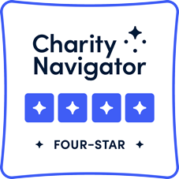
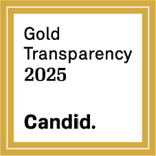

+++
title = "Home"

[extra]
site_title = "Prime Produce Limited"
+++

# Your grassroots community incubator

An ecosystem of support for people leading 501(c)3 not-for-profit initiatives

# People, serving purposefully. We call the fruits of this labor "Prime Produce."

Since 2007, Prime Produce Limited has stewarded a relational ecosystem within which do-gooders can cultivate their community service projects. We represent a grassroots ecosystem of friends, families, and neighbors committed to practicing community service.

Prime Produce Limited provides operational, strategic, and creative services for not-for-profit leaders and programs. Here are some of the things we often provide nonprofit leaders and their programs with:  
[**Nonprofit Services\!**](@/services/_index.md)  
[**Fiscal Sponsorship\!**](@/fiscal-sponsorship/_index.md)  
& [**Moral Support\!**](@/moral-support/_index.md)

We are a New York based 501c3 registered not-for-profit corporation (EIN: 26-1188925). We are organized to encourage and support other persons and exempt organizations, empowering future philanthropists through programs and projects.

Check us out on [Charity Navigator](https://www.charitynavigator.org/ein/261188925) or [Candid](https://www.guidestar.org/profile/26-1188925).

You can donate to our programs directly via their websites below (recommended) or by visiting our [donation portal](https://www.aplos.com/aws/give/PrimeProduceLimited/PPLdonations).

---

# Check out a few of our featured programs:

*(Please note that some programs listed are no longer active or have graduated out from our fiscal sponsorship program-- we list them here to share some of the interesting programming we have supported over the years\!)*

\[Program list: generated from the program subtabs of this tab, in subtab order.\]

# Learn More

**Financial Reports**

[FY2024 NYS Charities Filing, 990, & Engagement Review](https://drive.google.com/file/d/18S0w-RT9FUVgufl5aaFJo8aXnJj50Kkf/view?usp=sharing)  
[FY2023 NYS Charities Filing, 990, & Audit](https://drive.google.com/file/d/13hQeD0T2tesTGxl5CWSxwf9L7BxkD7BR/view?usp=sharing)  
[FY2022 Cover Letter, Audit](https://drive.google.com/file/d/1EvumyuJq1AG07wyivm5T3ZO3qPvPKFYF/view?usp=drive_link)  
[FY2022 990](https://drive.google.com/file/d/1N0KhngL1qiYahFCMpC2em4FIIobhR5cM/view?usp=sharing)  
[FY2021 990](https://drive.google.com/file/d/1UBTNQUaYrVava5-GpoOPyp0CIMuKV8Pq/view?usp=sharing)  
[FY2020 990](https://drive.google.com/file/d/1hzkj21mKrC-kgWSCfmu-GewrIVM485XF/view?usp=sharing)  
[FY2019 990](https://drive.google.com/file/d/10DlAexJm5SjtcomEYiokuaV4u3MMpbPF/view?usp=drive_link)

|  |  |
| ----- | ----- |
|  |  |

Check us out on [Charity Navigator](https://www.charitynavigator.org/ein/261188925) or [Candid/Guidestar](https://app.candid.org/profile/8634795/?pkId=59490e9c-484c-4a74-8044-4a1775ea0d84&isActive=true).

**Programming Reports**

*COMING SOON*

---

*Our volunteer network consists largely of people from the [Prime Produce NYC community collective](http://primeproduce.nyc). Check out this page if you want to see more pictures from our community programs\!*

---

*We are headquartered out of the Prime Produce Guildhall in Hell's Kitchen, operated by the [Prime Produce Apprentice Cooperative](http://primeproduce.coop). Check out [this page](http://primeproduce.coop/guildhall) if you want to learn more about our physical space and where we host most of our NYC-based events\!*

---
