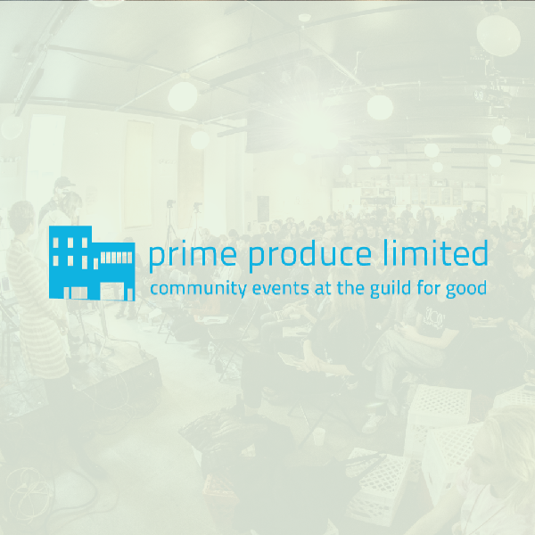

+++
title = "Community Events Series"
weight = 6
+++

# Our Community Event Series

### [See our Community Event Series in action\! Watch our 2-minute introduction video\!](https://youtu.be/0_8tRnRgK7E)

We launched our official **Community Event Series** in partnership with the [**Prime Produce Apprentice Cooperative**](http://primeproduce.coop) in order to support grassroots event organizers serving local, under-represented, and otherwise charitable community efforts. We know from our own experience that, in this age of disconnection, in-person interaction can be an irreplaceable cornerstone of any grassroots project and have structured this program as a way to support more equitable access to prime event space amidst the prohibitively high costs of space in New York City.

This program provides access to the \~7,000 sqft [Prime Produce Guildhall](https://www.primeproduce.coop/guildhall) and community center in NYC’s Hell’s Kitchen neighborhood at discounted rates for awarded recipients.

Since its official launch in 2022, the PPL Community Event Series has supported over 30 events and reached an audience of over 1,000 people. Example events range from multi-day film festivals featuring under-represented filmmakers to elder care enrichment programs to eco-culinary experiences highlighting native New York flora.

## We are actively seeking sponsors to help us underwrite this initiative\!

For more information on how you can become a part of this effort, please email Yuko@primeproduce.org

To apply for a space grant, please fill out [this form](https://tinyurl.com/PPLspacegrant).
