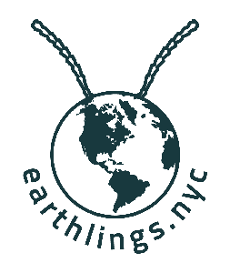

+++
title = "Earthlings.NYC"
weight = 15

[extra]
subtab = true
+++

# Earthlings.NYC

Years: 2022 \- Present

Tags: Environment & Sustainability, Education

Learn More: [https\://www\.earthlings.nyc/](https://www.earthlings.nyc/)

Earthlings NYC creates programming to nourish citizen science and ecology-related education in our communities. We are a 501(c)3 initiative affiliated with Seeds To Soil and Prime Produce, based out of the cooperatively-run Guild for Good guildhall at 424 West 54th St in Hell’s Kitchen. We provide opportunities for learners of all ages to interact with creatures they may not otherwise encounter living in New York City. Whether it’s a tiny little beetle grub or a hefty tortoise, there is always something living organisms can teach us about the world and about our selves\!
