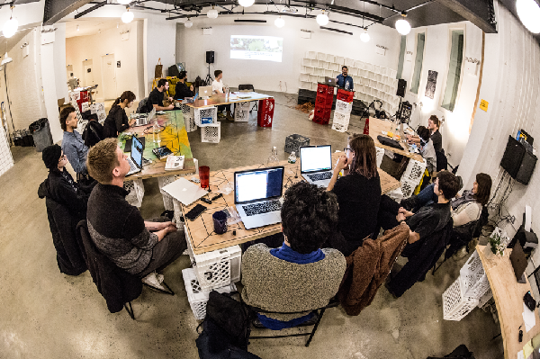
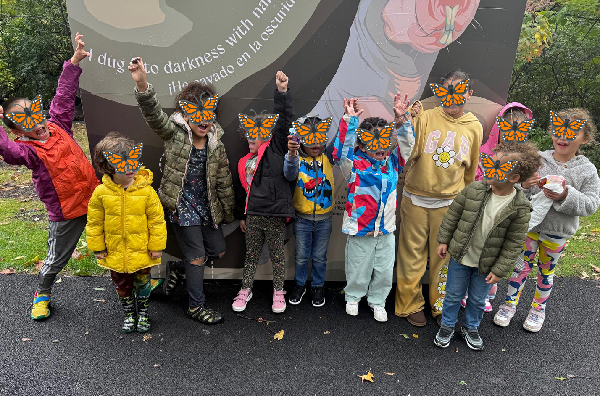

+++
title = "Fiscal Sponsorship"
weight = 19
+++

# Fiscal Sponsorship

> “Prime Produce Limited provided wonderful, personable support as a fiscal sponsor at an early and critical stage in the life of the U.S. Department of Arts and Culture. The team believed in our work and mission and provided meaningful back-end support so that—rather than having to form our own 501c3 at a moment in which it wasn’t essential or even strategic —we could focus on our program and core mission. Prime Produce offered much more than just a simple service, they offered a family and culture that it was a joy to be a part of\! Since then, the people-powered USDAC has grown into a grassroots action network of more than 18K artists, activists, and allies inciting creativity and social imagination to shape a culture of empathy, equity, and belonging.”  
>  **\~ Adam Horowitz, [USDAC](http://usdac.us)**

> “Working with PPL was an absolute pleasure. I especially appreciate the time and effort they took to understand our organizational goals/needs before considering if and how they could help. PPL went out of their way to establish new processes to support our affordable housing work we do in California. Jerone and the rest of the board offered their expertise and time generously to ensure the work that we did together align with both organizations’ goals and mission. As a result, I can genuinely say that the partnership and collaboration served as a force multiplier.”  
>  **\~ Joshua To, [Soup](https://www.soup.is/)**

> "Prime Produce is all about the power of pursuing what matters most as a team. That this is even a possibility is its daily lesson.”  
>  \~**Sarah Deutsch, SouperKitchen**

---

**Our Grassroots Community Incubator**  
 Prime Produce provides non-profit leaders with a corporate infrastructure foundation that includes essential compliance and financial oversight processes. We charge an administrative fee of 5%.

The true value of our platform, though, is the people. We offer an opportunity for leaders to chart their own self-directed journey through an ecosystem of do-gooders that includes designers, gardeners, musicians, strategists, presenters, mixologists, technologists, wildlife rehabilitators, librarians, and many many more good people. Through cooperative, creative, and ambitious mutual support we believe that this network of grassroots interdependence can be the key to nourish this next generation’s burgeoning not-for-profit initiatives.

NOTE: Our fiscal sponsorship programs enshrines a certain degree of autonomy and internal management for each program, but does impose important financial controls. This means that we are not a good fit for everyone. If you would like to inquire about joining the Prime Produce Limited portfolio of programs, please fill out [**this application form**](https://docs.google.com/forms/d/e/1FAIpQLScBYfXvY7Kz77V3oCSxL3N0x3ucWlSI0bJ1RTGlji_P3l9m9g/viewform?usp=sf_link)**.**

---

**PPL School Community Partnerships Program**  
 *Model A Fiscal Sponsorship for Parents, Teachers, and Grassroots School Initiatives*

The PPL School Community Partnerships Program is a new pilot that supports parents, teachers, and community organizers who want to strengthen their school communities through grassroots fundraising and community-led projects. Through this program, Prime Produce Limited provides Model A fiscal sponsorship for one school year at a time, making it possible for PTAs and similar groups to receive tax-deductible donations without needing to form their own nonprofit.

Each sponsored project submits a school-year budget and fundraising goal, which must be reviewed and approved by the PPL Board of Directors before launch. PPL manages the charitable funds, provides administrative oversight, and ensures compliance with federal and state nonprofit regulations throughout the year. Applicants must also provide a letter from the accredited educational school/institution verifying their knowledge and support of the proposed project.

PPL retains a 5% administrative fee, allowing us to support this offering sustainably while keeping barriers low for community members who want to make a positive impact in their school communities.

This program reflects PPL’s long-standing mission: empowering grassroots organizers with relational support, ethical structure, and accessible pathways to do good work for the communities they care about most.

To apply for a PPL School Community Partnership, please fill out [**this application form**](https://forms.gle/xHKs9VfrkJ8R14Qx5)**.**
