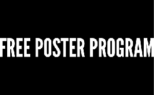

+++
title = "Free Poster Program"
weight = 5

[extra]
subtab = true
+++

# Free Poster Program

Years: 2012 \- Present

Tags: Education, Culture & Arts

Learn More: [http\://freeposterprogram.org](http://freeposterprogram.org)

The Free Poster Program is an experimental initiative providing educational materials to learners and educators that facilitate fresh exploration of school subjects. Our creative community riffs off of K-12 content to create posters and other art that enriches learning. Creating art, supporting educators, wondering beyond walls.
