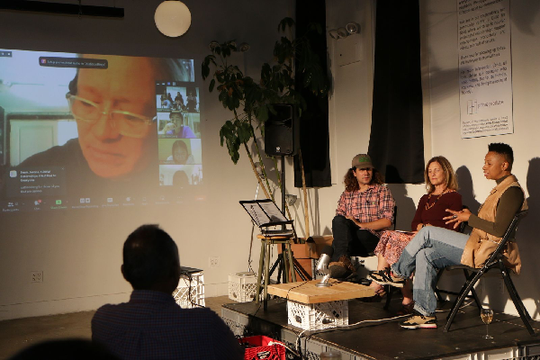
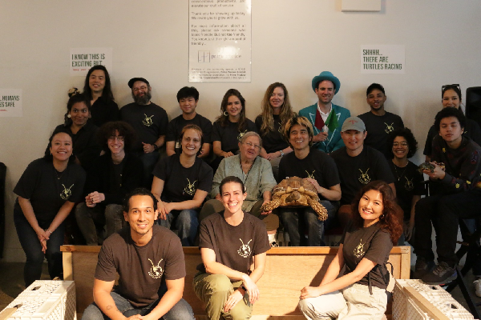
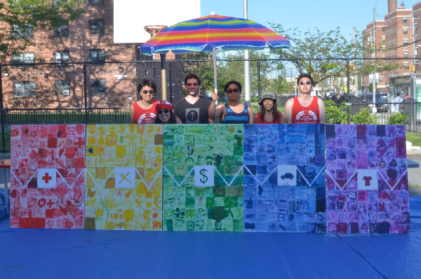

+++
title = "Gallery"
weight = 26
+++

# Gallery

 *In October of 2022, GROW Externshps hosted a panel “BIPOC, LGBTQIA2S+, Women, & the Climate Crisis: Why Representation Matters.” The team also prepared a 4 course plant-based meal for guests featuring native species from the region including ingredients specially foraged from the wild*.

 *The 2023 Charity Turtle Race volunteer team, organized by one of our newest initiatives, Earthlings.NYC. The event raised money for two PPL programs, Seeds to Soil and GROW Externships, as well as a local NYC partner, the NY Turtle and Tortoise Society.*

** *A participatory mural about emergency preparedness with the children and families at The Action Center in Far Rockaway after Hurricane Sandy.*
