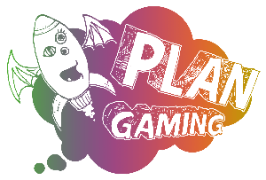

+++
title = "PLAN Gaming"
weight = 14

[extra]
subtab = true
+++

# PLAN Gaming

Years: 2021 \- Present

Tags: Community & Belonging, Health & Wellness

Learn More: [https\://www\.plangaming.org/](https://www.plangaming.org/)

PLAN (Peer Learning Adventure Network) Gaming is for folks who want to learn, practice, and have fun participating in role-playing and tabletop games. Through a social, networked approach with a complete focus in recreational activities we are able to engage and help people who might otherwise not seek such opportunities for cooperative, social, and creative engagement. The healing elements of games are hard coded in the magic that is recreational entertainment, helping people unlock themselves and be the people they would like to be in an environment which passively promotes relaxation and reinvigoration through enjoyable and non-demanding fun.
