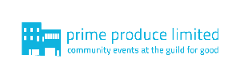

+++
title = "Prime Produce Community Event Series"
weight = 17

[extra]
subtab = true
+++

# Prime Produce Community Event Series

Years: 2021 \- Present

Tags: Nonprofit Support, Community & Belonging, Culture & Arts

Learn More: [Community Events Series](@/community-events-series/_index.md)

Hosted in partnership with the Prime Produce Apprentice Cooperative out of its \~7,000sqft guildhall in Hell's Kitchen, the Community Event Series supports a variety of up-and-coming nonprofit events, conscientious creative productions, and other free and low cost productions for the benefit of New Yorkers. From panels to showcases to performances, this program makes a centrally located venue accessible to emerging social good event producers.
