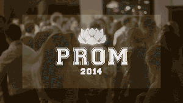

+++
title = "Prime Produce Open Benefits"
weight = 2

[extra]
subtab = true
+++

# Prime Produce Open Benefits

Years: 2010 \- 2018

Tags: Nonprofit Support, Community & Belonging, Culture & Arts

Learn More: [https\://vimeo.com/109661327](https://vimeo.com/109661327)

Prime Produce devised and produced the first “Open Benefit” in 2010\. Since then, Open Benefits have been held in New York City, San Francisco, and Honolulu. 100% of net proceeds from each themed event is donated to participating not-for-profits, proportional to their attendance. By bringing together young leadership and support networks in the nonprofit sector, we foster novel relationship-building between participants while simultaneously raising money for worthwhile causes. Whether interactive arts events or winter pool parties, each open benefit is a blend of wholesome fun, novel execution, and unadulterated goodness.
