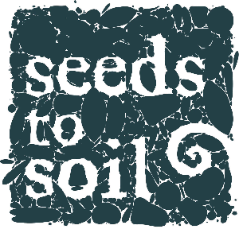

+++
title = "Seeds to Soil"
weight = 7

[extra]
subtab = true
+++

# Seeds to Soil

Years: 2017 \- Present

Tags: Environment & Sustainability, Education, Community & Belonging, Health & Wellness

Learn More: [http\://seedstosoil.org](http://seedstosoil.org)

Seeds to Soil is a collective of people who, through their respective practices, support and care for our urban ecologies, growing together in common spaces. From support for community gardens to grassroots social entrepreneurship to citizen science initiatives, this team is focused on developing nourishing ways to engage our urban ecologies.
