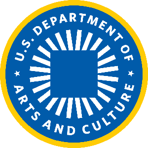

+++
title = "U.S. Department of Arts & Culture (USDAC)"
weight = 6

[extra]
subtab = true
+++

# U.S. Department of Arts & Culture (USDAC)

Years: 2016 \- 2018

Tags: Activism, Culture & Arts, Community & Belonging

Learn More: [http\://usdac.us](http://usdac.us)

The U.S. Department of Arts and Culture is a people-powered department — a grassroots action network inciting creativity to shape a culture of empathy, equity, and belonging.
