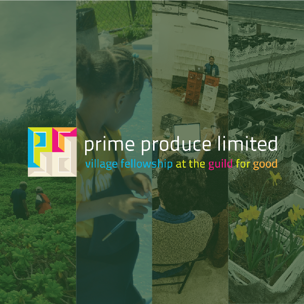

+++
title = "Village Fellowship"
weight = 5
+++

# Our Village Fellowship

  
 ***Supporting grassroots solutions within an ecosystem of friends, family, and neighbors.***

To support local social entrepreneurship and nonprofit leadership in our New York City neighborhoods, Prime Produce Limited is launching its first Village Fellowship at the Guild for Good. This is an opportunity for community service practitioners at any level to nourish and develop their practice and/or project within our vibrant interdisciplinary ecosystem.

Selected applicants will receive a space grant to utilize our \~1,000 sqft special events space, 24/7 access to our 3-story multipurpose guildhall as a part of membership with Prime Produce Apprentice Cooperative (up to 1 year with the option to continue beyond the fellowship), fellowship-specific microgrants to support their practice, a structured peer apprenticeship with a relevant subject matter expert, and opportunities to engage our broader network of mutual support.

## [**Help us make this fellowship (and this model of grassroots support) a reality\!**](https://www.aplos.com/aws/give/PrimeProduceLimited/VillageFellowship)

---

**APPLICATIONS NOW OPEN (& extended through February 29\)**

Fellowship recipients will be announced on March 15, with the fellowship commencing on April 1, 2024 and ending June 30th.

Applicants may apply in one or more of the following categories, which will each be reviewed by leading members of mission-aligned initiatives (*the categories below represent the kinds of projects we would like to support, but we will base final fellowship titles based on the preferences of the awarded recipients*).

* Fellowship for Social Justice & Activism  
* Fellowship for Justice-Impacted Communities  
* Fellowship for Arts & Creativity  
* Fellowship for Community & Belonging  
* Fellowship for Education & Pedagogy  
* Fellowship for Community-centered Design & Technology  
* Fellowship for Conservation and Ecology

## [**Apply to become part of the Village Fellowship\!**](https://forms.gle/NSqMrR1S7Ahvsm7q9)

Thanks for reading\!

---

## STAY CONNECTED

Want to stay in the loop about Village Fellowship applications and program updates?

### [Join our Mailing list\!](http://eepurl.com/gu7xv)

---
